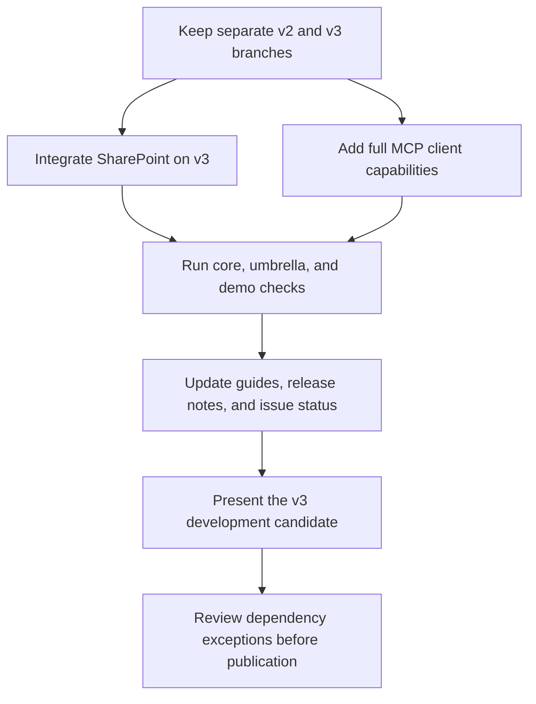

# Connect v3 release candidate

Scope: the `release/3.0` compatibility line. Keep `release/2.0` for v2 fixes.
Use the exact Action source revision. ArborMCP owns MCP protocol and transports.
The core package has no `jido_mcp` dependency. Do not publish packages as part
of this work.

| Work | Beadwork | State |
| --- | --- | --- |
| SharePoint on v3 | `jido_con-s91.1` | Landed at `74f41c69`; PR #66 closed |
| Tools, resources, prompts, completion, notifications, connection lifecycle | `jido_con-s91.2` | Implemented at `a783ef6d`; core, umbrella, and demo checks pass |
| Release record and issue cleanup | `jido_con-s91.3` | Checks recorded; #79 accepted and closed |
| Legacy notification delivery | `jido_con-zn1` | Retained through ArborMCP 2.0.0-rc.6 |

The MCP client work includes scoped access, pages, normalized errors, lease
expiry and revocation, host client ownership, and stream cleanup. Modern
notification streams use the public ArborMCP subscription API. Resources and
prompts preserve the MCP result maps. Tools retain the existing normalized
Connect result and approval flow.

ArborMCP 2.0.0-rc.6 supplies the public client event path for legacy, uncorrelated
resource and list-change notifications. Connect selects the legacy listener or
modern subscription through public ArborMCP APIs and keeps one host event contract.
See the guide for protocol-specific reconnect behavior and host callbacks.

ArborMCP makes Cowboy and Cowlib optional. The Connect client graph does not
select them, so the old Cowlib exceptions are removed. Connect and ArborMCP do
not call the affected encoders, and Connect does not publish a Cowboy server.
Jido and Jido Action use exact Git revisions. Jido Signal and ArborMCP use exact
prerelease versions.
These are publication checks, separate from the development candidate.
